# contrib-neon

Your GitHub contribution graph as an animated cyberpunk SVG: a CRT boot sweep lights the grid, cells glow and pulse harder the more you contributed that day, scanlines roll, and the odd glitch tears a row apart. Colors come from [Catppuccin](https://catppuccin.com).

<picture>
  <source media="(prefers-color-scheme: dark)" srcset="docs/demo-mocha.svg" />
  
</picture>

It's a single self-contained SVG (CSS animations + SVG filters, no scripts), so it works in a README ``. Viewers with reduced motion enabled get a static, glowing version.

## Usage

Add a workflow to your profile repo (`<you>/<you>`), e.g. `.github/workflows/contrib-neon.yml`:

```yaml
name: contrib-neon

on:
  schedule:
    - cron: "0 0 * * *"
  workflow_dispatch:

permissions:
  contents: write

jobs:
  generate:
    runs-on: ubuntu-latest
    steps:
      - uses: sm-steel/contrib-neon@v1
        with:
          github_user_name: ${{ github.repository_owner }}
          outputs: |
            dist/contrib-neon.svg?flavor=latte
            dist/contrib-neon-dark.svg?flavor=mocha

      # publish the SVGs to an `output` branch
      - uses: crazy-max/ghaction-github-pages@v4
        with:
          target_branch: output
          build_dir: dist
        env:
          GITHUB_TOKEN: ${{ secrets.GITHUB_TOKEN }}
```

Then embed it, switching with the viewer's theme:

```html
<picture>
  <source media="(prefers-color-scheme: dark)" srcset="https://raw.githubusercontent.com/<you>/<you>/output/contrib-neon-dark.svg" />
  /<you>/output/contrib-neon.svg" />
</picture>
```

## Options

Each `outputs` line is a file path with options as a query string. Write `#` in colors as `%23`, or leave it out.

| Option | Values | Default |
|---|---|---|
| `flavor` | `latte`, `frappe`, `macchiato`, `mocha` | `mocha` |
| `hud` | show the `// CONTRIB.LOG` header line | `true` |
| `glitch` | colour-split glitch tears | `true` |
| `color_levels` | 4 colors for activity levels 1-4 | flavor's blue, lavender, mauve, pink |
| `color_background` | panel color | flavor's crust (base for latte) |
| `color_empty` | color for days with no contributions | flavor's surface0 |

Example: `dist/neon.svg?flavor=frappe&glitch=false&color_levels=%2394e2d5,%2389dceb,%2374c7ec,%23a6e3a1`

Action inputs: `github_user_name` (required), `outputs` (required), `github_token` (defaults to the workflow token, which can read public contributions).

## CLI

From a clone (no install needed, Node 22.18+):

```sh
node dist/cli.js --user <login> --out "neon.svg?flavor=mocha" --token "$GITHUB_TOKEN"
```

## Development

Tools are pinned with [mise](https://mise.jdx.dev): `mise install && npm ci`.

- `npm test`, `npm run lint`, `npm run typecheck`
- `node src/preview.ts [login]` renders real (via `gh auth token`) and synthetic graphs into `preview/out/index.html` (serve that folder and open it) and refreshes `docs/demo-*.svg`
- `npm run build` bundles `dist/` (committed; CI checks it's current)

## License

MIT. The header text uses an embedded ASCII subset of [Monaspace Neon](https://github.com/githubnext/monaspace) (© 2023 GitHub, SIL Open Font License 1.1), renamed `ContribNeon Mono` as the OFL requires for modified versions; see [fonts/OFL.txt](fonts/OFL.txt). Rebuild it with `uv run scripts/build_font.py`.
